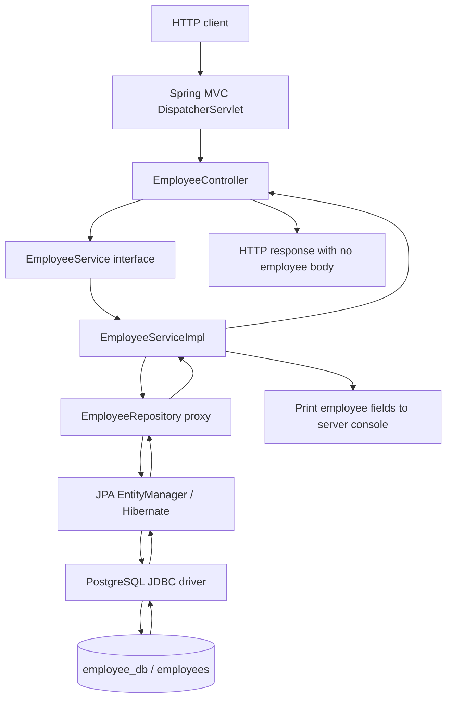

# Employee Query Service — Architecture and Spring Data JPA Notes

These notes describe the source code in this repository. Examples labeled **Learning example** are suggestions for practice; they are not implemented features.

## 1. Project purpose and technology

The application reads employee records from PostgreSQL through three HTTP GET endpoints: list employees, find by ID, and find by email.

| Technology | Role in this project |
| --- | --- |
| Java 17 | Java version configured in `pom.xml` |
| Spring Boot 4.1.1 | Parent version declared in `pom.xml`; application setup and dependency management |
| Spring Web MVC | HTTP routing and controller support |
| Spring Data JPA | Repository interfaces, inherited operations, and query methods |
| Jakarta Persistence (JPA) | Entity mapping API and persistence contracts |
| Hibernate | JPA provider supplied by the usual Boot JPA starter setup; translates persistence operations into SQL |
| PostgreSQL JDBC driver | Connects Java database operations to PostgreSQL |
| Maven | Build and dependency management |

Lombok is included in the build, but the current Java classes use explicit getters, setters, and constructors rather than Lombok annotations. Versions above are declarations from the build file, not a claim that the application was run successfully.

## 2. Architectural flow



Read the main dependency path as:

```text
Controller → Service → Repository → JPA provider → JDBC → Database
```

The database returns rows, Hibernate maps them to `Employee` objects, and the repository returns these objects to the service. The current service consumes the results and prints them. Both the service and controller methods return `void`, so the client does not receive employee JSON. Successful requests normally complete with HTTP 200 and an empty body.

### Layer responsibilities and source files

Paths below are relative to `src/main/java/com/dugrasoft/employee/`.

| File | Responsibility |
| --- | --- |
| `EmployeeQueryServiceApplication.java` | Starts Spring Boot |
| `controller/EmployeeController.java` | Maps incoming HTTP requests and extracts path variables |
| `service/EmployeeService.java` | Declares the operations available to the controller |
| `service/EmployeeServiceImpl.java` | Calls repository methods, handles missing results, and prints fields |
| `repository/EmployeeRepository.java` | Declares persistence operations for `Employee` |
| `entity/Employee.java` | Maps Java fields to database columns |

### Startup and dependency injection

1. Java executes `main(String[] args)`.
2. `SpringApplication.run(...)` creates the application context and starts the web application.
3. The main class is in `com.dugrasoft.employee`, making its subpackages the normal discovery area for application components, entities, and repositories under Boot's defaults.
4. Spring Data creates a repository proxy implementing `EmployeeRepository`.
5. Spring injects that repository into the `EmployeeServiceImpl` constructor.
6. Spring injects the service implementation into the `EmployeeController` constructor through the `EmployeeService` interface.

The constructors express required dependencies. A single constructor does not need `@Autowired`; `final` prevents reassignment of the dependency field. See [Spring Boot dependency injection](https://docs.spring.io/spring-boot/reference/using/spring-beans-and-dependency-injection.html).

## 3. Endpoint and method walkthrough

The controller's shared prefix is `/api/v1/employees`.

| HTTP request | Controller | Service | Actual repository call |
| --- | --- | --- | --- |
| `GET /api/v1/employees` | `getEmployees()` | `fetchEmployees()` | `findAll()` |
| `GET /api/v1/employees/1` | `getEmployee(Long id)` | `fetchEmployee(Long id)` | `findById(id)` |
| `GET /api/v1/employees/email/sai@example.com` | `getEmployeeByEmail(String email)` | `fetchEmployeeByEmail(String email)` | `findEmployeeByEmail(email)` |

### `fetchEmployees()`

```java
List<Employee> listOfEmployees = employeeRepository.findAll();
```

Retrieves all employee entities, loops through them, and prints email, first name, and last name. An empty result produces an empty list and no printed employee lines. This call is not paginated, and no explicit ordering is requested.

### `fetchEmployee(Long id)`

```java
Employee employee = employeeRepository.findById(id)
    .orElseThrow(() -> new RuntimeException("Employee Not found with id :" + id));
```

`findById` returns `Optional<Employee>`. `orElseThrow` unwraps a present employee or throws when absent. The service then prints the employee fields. There is no custom exception handler or HTTP status mapping in this project, so this exception ordinarily becomes HTTP 500, not HTTP 404.

### `fetchEmployeeByEmail(String email)`

Calls the explicit JPQL method `findEmployeeByEmail(email)`, unwraps its result, and prints the fields. The alternative call to `findByEmail(email)` is commented out. Its current missing-result message says “id” even though the value is an email.

### Entity accessor methods

`getId`, `getFirstName`, `getLastName`, and `getEmail` read fields. Their corresponding setters assign fields. These are ordinary Java methods, not repository queries. Because JPA mapping annotations are placed on fields, the entity uses field access for persistence. With no constructor explicitly declared, Java supplies the no-argument constructor required here by JPA.

## 4. Annotations used in the application

### Boot and web annotations

| Annotation | Where used | Meaning and effect |
| --- | --- | --- |
| `@SpringBootApplication` | Main application class | Combines Boot configuration, auto-configuration, and component scanning. Auto-configuration uses dependencies and settings to configure application infrastructure. |
| `@RestController` | `EmployeeController` | Combines controller registration with response-body semantics. A returned object can be serialized to the HTTP body; `void` supplies no employee object to serialize. |
| `@RequestMapping("/api/v1/employees")` | Controller class | Establishes the shared URL prefix for its request handlers. |
| `@GetMapping` | `getEmployees()` | Handles GET requests at the class-level path. |
| `@GetMapping("/{id}")` | `getEmployee(...)` | Adds a variable path segment under the shared prefix. |
| `@GetMapping("/email/{email}")` | Email handler | Adds a literal `email` segment followed by the email variable. |
| `@PathVariable` | Controller parameters | Binds a URI template value to a Java argument. The ID text is converted to `Long`; a nonnumeric ID normally causes HTTP 400. |

The current unnamed `@PathVariable` annotations rely on discoverable Java parameter names matching `{id}` and `{email}`. Explicit forms such as `@PathVariable("id") Long id` make the association visible in the source.

### Service and repository annotations

| Annotation | Where used | Meaning and effect |
| --- | --- | --- |
| `@Service` | `EmployeeServiceImpl` | A component stereotype that registers the implementation as a Spring bean and identifies its service-layer role. It does not automatically make every method transactional. |
| `@Repository` | `EmployeeRepository` | Identifies the persistence role. Spring Data repository discovery already registers this interface through its repository infrastructure; this annotation is not required for this interface to receive an implementation. |
| `@Query` | `findEmployeeByEmail(...)` | Supplies the query text explicitly. Here it is JPQL because `nativeQuery = true` is not set. |

The service interface itself has no annotation. Its implementation is the bean injected into the controller.

### JPA mapping annotations

| Annotation | Current usage | Meaning |
| --- | --- | --- |
| `@Entity` | `Employee` class | Makes the class a persistent entity; its default JPQL entity name is `Employee`. |
| `@Table(name = "employees")` | `Employee` class | Maps the entity to the `employees` table. |
| `@Id` | `Long id` | Identifies the entity's primary key. |
| `@GeneratedValue(strategy = GenerationType.IDENTITY)` | `id` | Uses database identity generation for inserted entity IDs. |
| `@Column(name = "first_name", nullable = false)` | `firstName` | Maps the field to `first_name` and declares that the database column must not be null. |
| `@Column(name = "last_name")` | `lastName` | Maps the field to `last_name`; no non-null requirement is declared. |
| `@Column(unique = true)` | `email` | Declares a unique column constraint. It does not make the column non-null. |

`nullable = false` and `unique = true` are persistence/schema metadata, not HTTP input validation annotations. Actual database constraints must exist to enforce these rules; schema-update configuration alone should not be treated as proof of the live schema.

| Java property | SQL column | Type in Java |
| --- | --- | --- |
| `id` | `id` | `Long` |
| `firstName` | `first_name` | `String` |
| `lastName` | `last_name` | `String` |
| `email` | `email` | `String` |

### Test annotations

`@SpringBootTest` loads a Boot application context for `EmployeeQueryServiceApplicationTests`. `@Test` marks `contextLoads()` as a JUnit Jupiter test. Its body is empty: success checks context startup, not endpoint behavior or returned employee data. With the current configuration, context startup can require a reachable PostgreSQL database.

## 5. What “declarative Spring Data JPA methods” means

You declare the operation as an interface method, and Spring Data supplies the implementation at runtime. You do not write an `EmployeeRepositoryImpl` for these operations or manually open JDBC connections and map result rows.

```java
public interface EmployeeRepository extends JpaRepository<Employee, Long> {
    Optional<Employee> findByEmail(String email);
}
```

`Employee` is the managed entity type; `Long` is its ID type. Interface methods are implicitly public and abstract, so writing `public` is optional.

There are three useful categories in this project:

| Category | Example | Where the behavior comes from |
| --- | --- | --- |
| Inherited operations | `findAll()`, `findById(id)` | Spring Data's repository implementation |
| Derived queries | `findByEmail(email)` | Parsed method name and entity properties |
| Declared queries | `findEmployeeByEmail(email)` with `@Query` | Explicit query text on the method |

Repository interfaces and generated implementations are introduced in the official [Accessing Data with JPA guide](https://spring.io/guides/gs/accessing-data-jpa/).

### Inherited repository methods

Only `findAll()` and `findById(...)` are called by the current service. The other methods below are available for future use through the inherited repository API; no corresponding write endpoints exist here.

| Method | Typical result | Purpose |
| --- | --- | --- |
| `findAll()` | `List<Employee>` | Retrieve all employees |
| `findById(Long id)` | `Optional<Employee>` | Look up the primary key |
| `existsById(Long id)` | `boolean` | Check whether the ID exists |
| `count()` | `long` | Count entities |
| `save(employee)` | Saved entity | Persist a new entity or merge an existing one according to entity-state detection |
| `saveAll(employees)` | List of saved entities | Save several entities; does not promise a single SQL statement |
| `deleteById(id)` | `void` | Delete by primary key |
| `findAll(Sort sort)` | `List<Employee>` | Retrieve with explicit sorting |
| `findAll(Pageable pageable)` | `Page<Employee>` | Retrieve a page with pagination metadata |
| `flush()` | `void` | Synchronize pending persistence-context changes with the database; flushing is not committing |

## 6. Derived query methods in detail

The current derived query is:

```java
Optional<Employee> findByEmail(String email);
```

Read this as `find` (retrieve entities), `By` (begin the predicate), and `Email` (the Java property `email`). Its conceptual SQL is:

```sql
SELECT id, first_name, last_name, email
FROM employees
WHERE email = ?;
```

The SQL is illustrative; generated aliases and formatting may differ. Values are bound as query parameters.

**Learning examples — declarations that could be added inside the repository:**

```java
List<Employee> findByFirstName(String firstName);
List<Employee> findByFirstNameAndLastName(String firstName, String lastName);
List<Employee> findByFirstNameOrLastName(String firstName, String lastName);
List<Employee> findByLastNameIsNull();
List<Employee> findByFirstNameContaining(String text);
List<Employee> findByEmailIgnoreCase(String email);
List<Employee> findByIdGreaterThan(Long id);
List<Employee> findByIdBetween(Long start, Long end);
List<Employee> findByLastNameOrderByFirstNameAsc(String lastName);
List<Employee> findTop3ByOrderByIdDesc();
boolean existsByEmail(String email);
long countByLastName(String lastName);
```

Use Java property names such as `FirstName`, not SQL column names such as `first_name`. The `Employee` entity has no `salary` or `department` fields, so queries using those properties cannot be derived from the current model. A repository comment mentioning salary and department does not add those fields.

For the supported keyword rules, consult [Spring Data JPA query methods](https://docs.spring.io/spring-data/jpa/reference/jpa/query-methods.html).

## 7. Explicit JPQL with `@Query`

The current declaration is:

```java
@Query("SELECT e FROM Employee e WHERE e.email=:email")
public Optional<Employee> findEmployeeByEmail(String email);
```

| Part | Meaning |
| --- | --- |
| `SELECT e` | Return employee entities |
| `FROM Employee e` | Query the entity named `Employee`, using alias `e` |
| `e.email` | Reference the entity's Java property |
| `:email` | Named bind parameter supplied by the method argument |

JPQL uses entity and property names. SQL uses table and column names. Thus JPQL refers to `Employee` and `e.firstName`; SQL refers to `employees` and `first_name`.

The current method has no `@Param`. Named binding can use retained Java parameter names when compilation enables `-parameters`. An explicit alternative is:

```java
// Learning example: replacement declaration with explicit binding.
// import org.springframework.data.repository.query.Param;
@Query("SELECT e FROM Employee e WHERE e.email = :email")
Optional<Employee> findEmployeeByEmail(@Param("email") String email);
```

`@Param("email")` connects the Java argument to `:email`. With `@Query`, the query text supplies the predicate rather than requiring it to be inferred from the method name. See [query declarations and parameter binding](https://docs.spring.io/spring-data/jpa/reference/jpa/query-methods.html).

**Learning example — native SQL alternative:**

```java
@Query(value = "SELECT * FROM employees WHERE email = :email", nativeQuery = true)
Optional<Employee> findUsingNativeSql(@Param("email") String email);
```

Here `nativeQuery = true` tells Spring Data to treat the text as database SQL. Prefer derived methods for simple conditions, JPQL for explicit entity queries, and native SQL when database-specific SQL is needed.

## 8. Choosing return types

| Return type | Appropriate use | Empty result |
| --- | --- | --- |
| `Optional<Employee>` | At most one matching employee | `Optional.empty()` |
| `List<Employee>` | Zero or more matching employees | Empty list |
| `Page<Employee>` | A page plus total-result metadata | Empty page content |
| `boolean` | Existence query | `false` |
| `long` | Count query | `0` |

`Optional<Employee>` does not silently choose one row from several. More than one matching row violates its single-result expectation and can cause an incorrect-result-size exception. The intended email uniqueness constraint supports the current exact-email lookup. An ignore-case search can match more than one differently cased email under some database uniqueness configurations, so the learning example uses a list.

**Learning example — paginated inherited query:**

```java
// Imports: org.springframework.data.domain.Page, PageRequest, Sort
Page<Employee> page = employeeRepository.findAll(
    PageRequest.of(0, 10, Sort.by("id").ascending())
);
List<Employee> employees = page.getContent();
```

Page indexes start at zero. Sort uses the Java property name. Pagination avoids loading the whole employee table for every request.

## 9. Transactions and modifying queries

The application declares no explicit `@Transactional` annotations. Inherited CRUD operations receive transaction settings from Spring Data's implementation; read operations are normally read-only. Newly declared query methods do not automatically inherit that same transaction configuration. A service transaction can group several repository calls into one unit of work. See [Spring Data JPA transactionality](https://docs.spring.io/spring-data/jpa/reference/jpa/transactions.html).

**Learning example — read transaction on a service method:**

```java
// import org.springframework.transaction.annotation.Transactional;
@Transactional(readOnly = true)
public void fetchEmployees() {
    // Existing repository read and processing logic goes here.
}
```

`readOnly = true` is a transaction/provider optimization hint, not a universal database-enforced ban on writes. In normal proxy-based transaction management, the call must pass through the Spring proxy; calling an annotated method from another method on the same instance does not establish a new intercepted transaction.

**Learning example — explicit update query, not present in this project:**

```java
// Imports:
// org.springframework.data.jpa.repository.Modifying
// org.springframework.data.repository.query.Param
// org.springframework.transaction.annotation.Transactional
@Transactional
@Modifying
@Query("UPDATE Employee e SET e.lastName = :lastName WHERE e.id = :id")
int updateLastName(@Param("id") Long id, @Param("lastName") String lastName);
```

`@Modifying` identifies an update/delete `@Query`; `@Transactional` supplies its transaction boundary, and the integer reports affected rows. Bulk updates can leave already-loaded entities stale in the persistence context, so refresh/clear behavior needs consideration when mixing bulk operations and entity reads. Ordinary select queries do not need `@Modifying`.

## 10. Configuration explained

Settings are in `src/main/resources/application.properties`.

| Setting | Current purpose |
| --- | --- |
| `spring.application.name` | Names the application `employee-query-service` |
| `spring.datasource.url` | Points to PostgreSQL at `localhost:5432`, database `employee_db` |
| `spring.datasource.username` / `password` | Database connection credentials; their values are intentionally not duplicated here |
| `spring.datasource.driver-class-name` | Selects `org.postgresql.Driver` |
| `spring.jpa.database-platform` | Explicitly selects Hibernate's PostgreSQL dialect |
| `spring.jpa.hibernate.ddl-auto=update` | Requests schema updates based on entity mappings at startup; does not create the PostgreSQL database itself |
| `spring.jpa.show-sql=true` | Displays generated SQL |
| `spring.jpa.properties.hibernate.format_sql=true` | Formats the displayed SQL |

The database must exist and be reachable using the configured credentials. Set the `DB_PASSWORD` environment variable before starting the application; the database password is not stored in the published configuration. No seed-data script is present in the inspected source. Schema generation and data population are separate operations.

## 11. Current behavior versus possible improvements

| Current code | Possible follow-up change |
| --- | --- |
| Controller and service methods return `void` | Return employees or response DTOs so the client receives JSON |
| Missing employee throws generic `RuntimeException` | Add a dedicated exception and HTTP 404 mapping |
| Employee data is printed using `System.out.println` | Use application logging for diagnostics |
| Email error text refers to an ID | Change the text to refer to email |
| `findAll()` loads every employee | Expose pagination for larger datasets |
| Context startup is the only test | Add repository and endpoint behavior tests |

To return JSON, both layers' contracts must change consistently: for example, `EmployeeService.fetchEmployee` could return `Employee`, its implementation could return the repository result, and the controller could return that result. Merely adding `@RestController` cannot turn a `void` method into an employee response.

## 12. Quick revision questions

1. **Who implements `EmployeeRepository`?** Spring Data supplies a runtime proxy backed by its repository infrastructure.
2. **Why use `JpaRepository<Employee, Long>`?** It defines the managed entity and identifier type and exposes inherited persistence operations.
3. **What is the difference between `findByEmail` and the current `findEmployeeByEmail`?** The first derives its query from the method name; the second uses explicit JPQL from `@Query`.
4. **Does JPQL use `employees`?** This project's JPQL uses the entity name `Employee`; `employees` is the SQL table name.
5. **Why `Optional<Employee>`?** A lookup may find no employee, and the caller must decide how to handle absence.
6. **Why no `@Autowired`?** Each injected class has one constructor, which Spring can select automatically.
7. **Does this API currently return employee JSON?** No. It prints employee fields on the server and returns no employee body.
8. **Does a missing employee automatically mean HTTP 404?** No. The current generic exception has no 404 mapping.
9. **Is `@Column(nullable = false)` request validation?** No. It is persistence mapping metadata for a non-null database column.
10. **Is every repository method a derived query?** No. Inherited methods, derived queries, and explicit query declarations are distinct mechanisms.
